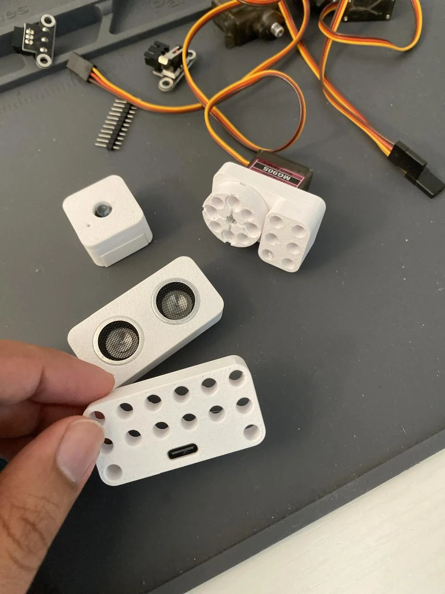

# OpenProto™

**Plug-in robotics modules that connect to a main board with ordinary USB-C cables, mount on the LEGO® Technic grid, and are programmed from a web browser.**

Public design disclosure, version 1, first published 2026-11-03.
Author: Yabudullah Ahmed Bakhtiar. The **3D-printable hardware** of **OpenProto Zero** (housings, hubs and mounting parts) is open source under CERN-OHL-S v2, and this document is under CC BY-SA 4.0. The software and firmware are **not** open source, and the custom-PCB edition's licensing is not decided yet (see [Licences](#licences)).

This document describes OpenProto in enough detail for an engineer to understand and reproduce the ideas. It is published as a dated public record of the ideas below; describing software here does not release its source code. Status: working prototype in progress (hand-wired main board, 3D-printed module housings).

*First printed module housings (photo taken 2026-11-03).*

---

## Contents
1. [The idea](#1-the-idea)
2. [The first kit: OKC 1](#2-the-first-kit-okc-1)
3. [The port: how modules connect](#3-the-port-how-modules-connect)
4. [Main board](#4-main-board)
5. [Modules and their wiring](#5-modules-and-their-wiring)
6. [How modules are identified](#6-how-modules-are-identified)
7. [Firmware: the port manager](#7-firmware-the-port-manager)
8. [Browser scripting with hot reload](#8-browser-scripting-with-hot-reload)
9. [Printed housings and mounting](#9-printed-housings-and-mounting)
10. [OpenProto Zero and the custom-PCB version](#10-openproto-zero-and-the-custom-pcb-version)
11. [Future ideas](#11-future-ideas)
12. [Licences](#licences)

---

## 1. The idea

A robot is built from **modules** (motors, servos, sensors, a camera) and one **main board** ("brick"). Every module plugs into any port on the main board with a standard USB-C to USB-C cable. The cable carries power and signals. There are no breadboards and no jumper wires.

Rules that hold across the whole system:
- **One cable is enough for a basic module.** Any module works from a single port and cable. Modules may also carry **extra USB-C ports**: a **dedicated power port** (USB-C power delivery for high-current modules such as larger motors, so the main board's port only carries signals and logic power) and a **pass-through port for daisy chaining**, so further modules plug into the module instead of the main board.
- **Every port is identical.** Any module works in any port; the port's function is set in firmware.
- **Module electronics depend on the edition.** In **OpenProto Zero**, simple modules use off-the-shelf components with no microcontroller and wire straight to the main board's pins. In the custom-PCB edition, modules may carry their **own small microcontroller** and talk to the main board over **I2C** (or the serial link), which gives each module an address, lets several modules share one chain, and lets a module report what it is. Modules that need more than two signal lines are **smart modules** with their own microcontroller in either edition.
- **Housings sit on the LEGO Technic 8 mm grid**, so modules mount on Technic beams, pins and axles.
- **Programmed from a browser.** The main board serves a web page with a code editor; code changes run immediately (hot reload) without unplugging or reflashing.

## 2. The first kit: OKC 1

"OKC" is a tribute to Ole Kirk Christiansen, who founded LEGO in his workshop in 1932.

| Module | Qty | Type | Signal lines used |
|---|---|---|---|
| DC motor module (TT gear motor 1:90 + DRV8833 driver) | 2 | Simple | P1 = IN1, P2 = IN2 |
| Servo module (MG90S) | 2 | Simple | P1 = servo A, P2 = optional servo B |
| Touch sensor (mechanical switch) | 2 | Simple | P1 = switch A, P2 = optional switch B |
| Rotation sensor (AS5600 magnetic angle sensor) | 2 | Simple, I2C | P1 = SDA, P2 = SCL |
| Ultrasonic distance sensor (RCWL-1601) | 2 | Simple | P1 = trigger, P2 = echo |
| Main brick (ESP32-S3) | 1 | — | — |
| Camera module (ESP32-S3 with camera), add-on | 1 | Smart | UART on P1/P2 + Wi-Fi video |

Builds the kit covers: a robot car (two motors, two ultrasonic sensors, touch sensors as bumpers), a servo arm or pan/tilt head, angle-measuring builds with the rotation sensors, and camera tracking (faces, colours) with the add-on.

## 3. The port: how modules connect

### 3.1 What a USB-C cable actually carries
A standard USB 2.0 C-to-C cable has five conductors: **VBUS, GND, D+, D−, and one CC wire**. SuperSpeed pairs and SBU lines are not present in USB 2.0 cables. OpenProto uses all five, and nothing else, so any cheap data-capable USB-C cable works.

### 3.2 Port pinout (spec v0.3)

| Port wire | USB-C contacts | Use |
|---|---|---|
| VBUS | A4, A9, B4, B9 | 5 V module power (4.75–5.25 V) for motors, servos and smart modules |
| GND | A1, A12, B1, B12, shell | Common ground |
| **P1** | D+ (A6 and B6 joined) | Signal 1, 3.3 V logic. On the main board, P1 is always an ADC-capable pin |
| **P2** | D− (A7 and B7 joined) | Signal 2, 3.3 V logic |
| **3V3** | CC (A5 and B5 joined) | A low-current **3.3 V supply** for sensors (≤ 50 mA per port, ≤ 200 mA total). Never a signal |

- **Flip-proof.** D+ is joined across both rows (A6 + B6), D− likewise, and CC1 + CC2 are joined at both ends. A USB 2.0 cable never swaps D+ and D−, so P1 and P2 are the same in either plug orientation, and the single CC wire reaches the joined CC pins either way.
- **3.3 V on the CC wire.** Using CC as a 3.3 V supply lets 3.3 V sensors (magnetic encoder, ultrasonic) run without a regulator or level shifter on the module, while motors and servos use 5 V VBUS. The breakouts' 5.1 kΩ Rd resistors can stay in place: they cost about 1.3 mA per board. With 3.3 V on CC, a USB charger plugged into a port by mistake sees 3.3 V instead of Rd and keeps its output off. E-marked cables put about 1 kΩ (Ra) on the second CC contact of each plug, which wastes about 3 mA but does no harm on a supply line.
- **3.3 V logic only on P1 and P2**, even though VBUS is 5 V. The main board's pins are not 5 V tolerant.
- **Series resistors.** Every simple module has a 330 Ω resistor in series on each signal line it uses, between the connector and the module's circuit. This limits current to about 10 mA when two outputs fight, a switch shorts an output to ground, or one side is unpowered. (On a production main board the resistors move to the main board, about 220 Ω per line.)
- **No pull-ups on the main board.** I2C modules bring their own pull-ups to 3.3 V. This keeps every port universal.
- **Direction convention.** Where a module has one signal each way, P1 = main board → module and P2 = module → main board (UART: P1 = main board TX; ultrasonic: P1 = trigger, P2 = echo). Exceptions: analog outputs and single switches use P1 (only P1 has an ADC); I2C uses P1 = SDA, P2 = SCL.
- Anything needing more than two lines uses I2C (an expander or microcontroller on the module) or becomes a smart module on UART.

### 3.3 Port modes
Every port offers every mode; the ESP32-S3 GPIO matrix routes the right peripheral to that port's pins when a module is assigned.

| Mode | P1 | P2 | Peripheral |
|---|---|---|---|
| Digital in / out | yes | yes | GPIO |
| Analog in (0–3.1 V) | yes | no | ADC1, 12-bit |
| PWM (motors 20 kHz, servos 50 Hz) | yes | yes | LEDC, 8 channels |
| UART (smart module) | TX | RX | UART1, UART2 |
| I2C | SDA | SCL | 2 hardware controllers, or software I2C |
| Pulse timing (ultrasonic echo) | — | yes | GPIO timing, later RMT |
| Encoder counting | yes | yes | PCNT, 4 units |

## 4. Main board

Prototype: an **ESP32-S3 N16R8** development board (16 MB flash, 8 MB octal PSRAM) on perfboard, with up to **8 ports**, each a USB-C breakout (USB 2.0, 16-pin receptacle) wired as in section 3.

### 4.1 Pin map
| Port | P1 (D+) | ADC channel | P2 (D−) |
|---|---|---|---|
| 1 | GPIO1 | ADC1_CH0 | GPIO11 |
| 2 | GPIO2 | ADC1_CH1 | GPIO12 |
| 3 | GPIO4 | ADC1_CH3 | GPIO13 |
| 4 | GPIO5 | ADC1_CH4 | GPIO14 |
| 5 | GPIO6 | ADC1_CH5 | GPIO15 |
| 6 | GPIO7 | ADC1_CH6 | GPIO16 |
| 7 | GPIO8 | ADC1_CH7 | GPIO17 |
| 8 | GPIO9 | ADC1_CH8 | GPIO18 |

P1 pins are all on ADC1, because ADC2 cannot be used while Wi-Fi is on. Pins never used for ports: GPIO0, 3, 45, 46 (boot straps), 19 and 20 (native USB), 43 and 44 (UART0 console), 26–32 (flash), 33–37 (octal PSRAM). GPIO10 is reserved as a VBUS rail monitor.

### 4.2 Power
- **Two feeds, one ground.** The ESP32-S3 board runs from its own USB connection (a PC while developing, or one output of a power bank). The port rail runs from a second 5 V supply (a second power-bank output, ≥ 3 A total) through a USB-C power-input breakout. This keeps motor current away from the ESP32's regulator. The ESP32 board's 5 V pin is never connected to the port rail, so the rail can't back-feed a laptop.
- **3.3 V to the ports** comes from the ESP32 board's 3.3 V pin, wired to the joined CC pins of every port.
- **Bulk capacitor**: 1000 µF across the port rail at the input; each motor and servo module adds its own 100–220 µF.
- **Power sequencing**: power both feeds together and unplug the rail first. If the firmware sees every smart and I2C module drop at once, it assumes the rail died and turns every port pin into an input, so the ESP32 can't back-power dead modules through their signal lines.

## 5. Modules and their wiring

Each simple module contains: a USB-C breakout (USB 2.0 receptacle, CC1 and CC2 joined), the module's off-the-shelf board or part, 330 Ω series resistors on the signal lines, and decoupling capacitors where needed.

### 5.1 DC motor (TT gear motor + DRV8833)
| From | DRV8833 board | Note |
|---|---|---|
| VBUS | VCC (VM) | 5 V motor supply |
| GND | GND | |
| P1 → 330 Ω | IN1 + IN3 (joined) | Both H-bridges in parallel, which doubles current capacity (a TT motor can stall near 1 A) |
| P2 → 330 Ω | IN2 + IN4 (joined) | |
| Motor lead 1 | OUT1 + OUT3 (joined) | |
| Motor lead 2 | OUT2 + OUT4 (joined) | |
| — | EEP / nSLEEP → VCC | If the board doesn't already pull it high |

100 nF across the motor terminals, 100–220 µF across VCC–GND. At boot the ESP32 pins are inputs and the DRV8833 inputs have internal pull-downs, so the motor coasts and can't start on its own. Drive: 20 kHz PWM, slow decay (forward = IN1 high, IN2 PWM at 1 − speed; reverse mirrored; both low = coast, both high = brake), ramp-limited, with a short brake before reversing.

### 5.2 Servo
The servo module is a printed housing for the servo. The port side is a **servo adapter**: a USB-C breakout with one or two 3-pin servo headers (VBUS = red, GND = brown, P1 → 330 Ω → signal A, P2 → 330 Ω → signal B), plus 220–470 µF across the supply. One port drives two servos (e.g. pan and tilt on one cable). 50 Hz PWM at 3.3 V logic, slew-rate limited, servo starts staggered by 100 ms to avoid current spikes.

### 5.3 Ultrasonic distance sensor (RCWL-1601)
Powered from the port's **3.3 V on CC**, so the echo output can never exceed 3.3 V (no divider needed). P1 → 330 Ω → TRIG, P2 → 330 Ω → ECHO. Firmware: 10 µs trigger, pulse-width timing with a 30 ms timeout, distance = t × 0.0343 / 2 cm, at least 60 ms between pings, several sensors pinged round-robin, median of 3.

### 5.4 Touch / bumper / endstop switch
A bare switch: COM → GND, contact → 330 Ω → P1 (second switch on P2). Normally-closed wiring is preferred for endstops (a broken wire reads as "triggered", which is fail-safe). The ESP32's internal pull-up replaces a board resistor. A 3-pin switch board with an LED may be powered from the port's 3.3 V (never from 5 V, which would put 5 V on the signal). Firmware: edge interrupt plus 10 ms debounce; each switch is configured as NC or NO so `pressed()` means the same either way.

### 5.5 Rotation sensor (AS5600)
Powered from the port's 3.3 V (VDD5V and VDD3V3 tied for 3.3 V operation). P1 → 330 Ω → SDA, P2 → 330 Ω → SCL, DIR tied to GND. A diametrically magnetised 6 × 2.5 mm magnet sits 0.5–3 mm above the chip, on a shaft or hub. The AS5600's fixed address (0x36) means each port gets its own I2C bus (hardware I2C for two ports, software I2C beyond). The driver reads the 12-bit raw angle and the magnet status, unwraps multi-turn rotation, and **whitelists writes**: only register-pointer writes to read-only registers are allowed, so the chip's one-time-programmable memory (BURN command) can never be written by accident.

The rotation sensor's housing has a hub that fits the TT motor's rear (second) output shaft or a Technic cross axle. TT motor module + rotation sensor = a do-it-yourself positional motor, where the learner writes the control loop.

### 5.6 Smart modules (camera, dual stepper)
A smart module is a small microcontroller board with its own USB-C connector, e.g. an ESP32-C3 Super Mini (dual stepper driver) or a Seeed XIAO ESP32-S3 Sense (camera). The port cable plugs straight into the board's own USB-C connector. The module firmware **turns the native USB D+/D− pins into a UART** (115200 8N1):

| Port wire | Main board | ESP32-C3 Super Mini | XIAO ESP32-S3 Sense |
|---|---|---|---|
| P1 (D+) | UART TX | GPIO19 → RX | GPIO20 → RX |
| P2 (D−) | UART RX | GPIO18 → TX | GPIO19 → TX |
| VBUS | 5 V | Board's own 3.3 V regulator | Same |

- **Explicit mode**: by default the module boots into main-board mode (native USB off, UART on those pins, TX idling high). Pressing the module's BOOT button within 1 s of plugging it in keeps native USB on (**PC mode**), so the same module can be controlled directly from a PC or phone browser. Holding BOOT while plugging in still enters the ROM bootloader for reflashing.
- **Protocol (draft)**: ASCII lines ending in `\n`, at most 128 bytes. `info` → `{"type":"stepper2","fw":"0.1"}`; commands reply `ok …` or `err …`; asynchronous events start with `evt`; `ping` → `pong` every 500 ms (three missed pongs = unplugged). The same commands work over UART from the main board, over USB from a PC, and over BLE, so any controller can drive any smart module and a UI can be generated from the `info` reply.
- **Dual stepper module**: ESP32-C3 + 2× ULN2003 driving two 28BYJ-48 steppers, 5-pin sockets for the motors and 3-pin sensor sockets (signal, GND, 3.3 V) for endstops or analog angle sensors on ADC pins. Pin plan: sensors GPIO0, 1; stepper A GPIO3–6; stepper B GPIO7, 10, 20, 21; port UART GPIO18, 19.
- **Camera module**: streams video over Wi-Fi and reports detections (faces, colours) over the UART link; vision runs on the module.

## 6. How modules are identified

Layered, cheapest first:

1. **Line signature (passive check).** Every 500 ms, each empty port's P1 and P2 are read with the ESP32's internal pull-downs on (harmless to every module):

| P1 | P2 | Means | Action |
|---|---|---|---|
| LOW | LOW | Empty, or a simple module | Simple modules are assigned in the UI |
| LOW | HIGH | Smart module (its UART TX idles high, its RX has no pull-up) | UART probe: send `info` |
| HIGH | HIGH | I2C module (both lines pulled up by the module) | I2C probe at known addresses (0x36, 0x5A, 0x68, 0x69, 0x38…) |
| HIGH | LOW | Unknown driver on P1 | Port blocked, reason shown |

A signature must read the same three times, 500 ms apart, before probing.
2. **Smart modules report themselves** (type, firmware version) over UART.
3. **I2C modules are found by address**, then confirmed with read-only registers.
4. **Simple modules** (motor, servo, switch, ultrasonic) are picked in the browser UI and remembered per port.
5. **Planned for custom PCBs:** an **ID resistor** on each simple module and plug-in detection by sensing each port's 3.3 V current (every module draws some, an empty port draws none). See section 11.

## 7. Firmware: the port manager

MicroPython on the ESP32-S3 (`ESP32_GENERIC_S3`, `SPIRAM_OCT` variant). Each port is in one of five states: EMPTY (pins are inputs, passive check running), PROBING, SMART or I2C (peripheral routed), ASSIGNED (configured for a simple module picked in the UI), BLOCKED (with a reason shown in the UI).

Safety rules:
- At boot every port pin stays an input until assigned. Saved assignments are applied only after the pre-drive check passes.
- **Probing never drives against an output**: the UART probe only runs on a smart-module signature (it drives P1 into the module's RX), the I2C probe only on an I2C signature (open-drain, pulling down against resistors only).
- **Pre-drive check**: before a pin becomes a push-pull output for a simple module, it is read with the pull-down on. HIGH means something else drives that line, so the port is blocked ("Port 3: expected a motor, found something on P2").
- Weakest drive strength on port pins; a peripheral allocator hands out UARTs, I2C controllers, PWM channels and pulse counters per port, and blocks a port with a reason when one runs out.
- Unplug detection for smart modules (missed pongs) and I2C modules (failed reads); rail-loss detection turns every port pin into an input.
- Actuator safe states: on hot reload, script error or stop, motors coast and servos hold their last pulse; in remote-control mode motors coast if no command arrives for 500 ms. Hot reload never resets the board.

## 8. Browser scripting with hot reload

- The main board serves a web page (over its own Wi-Fi hotspot or the local network) with a code editor, a live **port map** (what's plugged into each port, with live sensor values) and controls.
- Users write Python against simple module objects: `motor.speed(50)`, `servo.angle(90)`, `ultrasonic.distance()`, `button.pressed()`, `rotation.angle()`, `stepper.move(2048)`, `stepper.home()`, `camera.find_face()`.
- **Hot reload**: saving the script replaces the running user code without resetting the board, so PWM keeps running, servos don't go limp, and smart modules stay connected. Only the user's code is restarted; the port manager keeps running.
- Works on any device with a browser, including Chromebooks, with nothing to install.
- An optional AI helper explains errors and gives hints; the learner still writes the code.

## 9. Printed housings and mounting

- Housings are 3D printed (PLA or PETG) and sized in **Technic modules** (1 M = 8 mm). Outside dimensions are whole modules minus a small clearance (e.g. 10 × 3 × 5 M = 79.8 × 23.8 × 39.8 mm).
- **Pin holes**: Ø 4.8 mm on the 8 mm grid, with a Ø 6.2 × 0.8 mm counterbore at each face, through solid regions of the housing (e.g. a "pin rail" under a motor), plus blind holes from the bottom face. Cross-axle sockets: 4.8 mm cross, 1.8 mm arms. Printed holes are tuned with a fit-test coupon (typically +0.1 to +0.2 mm).
- **Motor module example (concept)**: TT motor lying flat, output shaft centred on a grid hole; DRV8833 and the USB-C breakout in a shallow bay above the motor; the breakout turned so the USB-C opening exits a side wall (keeping the module 3 M wide); clamshell halves split on the motor's centre plane; two M3 bolts pass through both halves **and the motor's own mounting holes**, so one pair of bolts clamps everything; the motor's front tab keys into a pocket in the front wall.
- **Output hub**: a printed boss pressed onto the TT motor's double-flat shaft (Ø 5.4 mm, 3.7 mm across flats), topped by a three-hole bar on the Technic grid (pin hole, cross-axle socket, pin hole, 8 mm apart), like a short liftarm. The cross socket begins past the shaft tip. On a dual-shaft motor the second shaft gets a second hub, or a magnet for the rotation sensor.
- **USB-C opening**: about 9.2 × 3.6 mm with a 0.5 mm chamfer; a printed shoulder behind the breakout takes the plug-in force.
- **Servo module**: the servo sits in a printed Technic housing; the servo cable goes to a servo adapter (section 5.2).
- **Threaded inserts**: housings include heat-set brass threaded inserts (e.g. M3) on the module faces, so a module can be bolted to anything outside the Technic system (aluminium extrusion, wood, plates, brackets, other machines) as well as mounted on the 8 mm grid.
- Design workflow: drafts in any CAD tool, final models as parametric CAD with named parameters, released as STEP (reference) and 3MF (printing).

## 10. OpenProto Zero and the custom-PCB version

OpenProto exists in two forms that share one port, one protocol and one mounting grid, so their modules mix in the same robot.

| | **OpenProto Zero** | **OpenProto (custom PCB)** |
|---|---|---|
| Built from | Common off-the-shelf boards (ESP32 dev boards, DRV8833 boards, USB-C breakouts, hobby sensors) + 3D-printed housings | Purpose-made compact PCBs (one board per module) |
| Module electronics | Simple off-the-shelf components, no microcontroller in simple modules | Modules may have their own microcontroller (I2C/serial), an extra USB-C power port, and a pass-through port for daisy chaining |
| Who builds it | Anyone with a soldering iron and a 3D printer, from parts sold worldwide | Assembled and tested modules |
| Size | Larger housings | Compact |
| Source | **3D-printable hardware open source** (housings, hubs, mounting parts); software and firmware not open source | Licence not decided yet; its design files are **not** released in this repository |

Shared between both: the USB-C port pinout (section 3), the smart-module protocol, the browser software, and the Technic grid. OpenProto Zero exists so that people anywhere can build the system from local parts without a PCB fab. The port and protocol are documented in this README so that both editions remain compatible; the software itself is not released as open source.

The custom-PCB edition's ideas are described in this document as a public record; publishing a description here does not release its schematics, PCB layouts or firmware.

## 11. Future ideas

- **Qwiic / STEMMA QT-compatible port**: a 4-pin JST SH (1 mm pitch) I2C port on the main board and/or on modules, wired to the common pinout (GND, 3.3 V, SDA, SCL), so the large existing range of third-party I2C sensors and boards plugs straight into OpenProto without adapters. The port manager detects devices on it by I2C address like any other I2C module. (Qwiic is a trademark of SparkFun Electronics and STEMMA QT of Adafruit Industries; OpenProto is not affiliated with either.)
- **Daisy chaining**: a module's pass-through USB-C port forwards the chain's power and bus lines, so modules connect in series (main board → module → module …). With a microcontroller in each module on a shared I2C bus (or an addressed serial bus), each module gets an address assigned at plug-in or set at build time, and the main board finds every module on the chain by scanning it.
- **Dedicated power port**: high-current modules (larger motors, steppers, actuators) take power from their own USB-C power-delivery input (negotiating a higher voltage such as 9–20 V), with logic power and signals still coming from the main board port; the module keeps the two grounds common and protects against back-feeding.

Not built yet. Listed here so they are part of the public record.

**Ports and connection**
- **ID resistor per simple module**: a resistor from a spare line to GND, read by the main board's ADC at plug-in to tell module families apart (e.g. a 10 k–470 k E24 ladder; about 8 codes with the ESP32 ADC, about 16 with a 12-bit external ADC), then the line is released for normal use.
- **Plug-in detection by current**: a current-limited load switch per port on VBUS and on the 3.3 V CC supply; a module is "present" when it draws current on 3.3 V; VBUS stays off until a module is seen (protects a laptop plugged in by mistake).
- Per-port ESD protection on D+/D− clamping to 3.3 V, series resistors on the main board, a VBUS rail monitor, soft-start per port.
- **Single-wire half-duplex serial** to very small module microcontrollers (e.g. ATtiny85) on P1, leaving P2 free, with addressed packets so several modules can share one line (servo-bus style).
- Using a Digispark-style ATtiny85 USB board as a module: the cable's D+ lands directly on the ATtiny's pin, so the main board can bit-bang serial to it while the same connector still programs it from a PC.
- **Two-wire full-step stepper drive**: in two-phase full stepping, IN3 = NOT IN1 and IN4 = NOT IN2, so two signal lines plus an inverter drive a ULN2003 stepper from one port.
- I2C GPIO expander (PCF8574 class) modules for digital modules needing more than two lines.
- An **I2C or UART bootloader** in smart modules so the main board updates module firmware over the port.
- Each smart module controllable directly from an Android phone over USB-C OTG (phone powers the module through the module's 5.1 kΩ Rd; WebUSB / Web Serial), or over BLE from any phone.

**Main board**
- **Two-chip main board**: ESP32-S3 as the "brain" (user scripts, Wi-Fi/BLE, browser UI, USB) and an STM32 (e.g. STM32G0B1) as the I/O chip owning every port (good 12-bit ADC on every P1, PWM, UARTs for smart modules, timers for encoders), linked by SPI. **Users only program the ESP32; the ESP32 flashes the STM32** through the STM32's built-in UART bootloader by driving its BOOT0 and NRST pins, with firmware images stored in the ESP32's flash and updated from the browser.
- **Machine modes**: the I/O chip's firmware is swapped from the browser: normal OpenProto I/O firmware; Klipper MCU firmware (3D printers, with a Klipper host on a PC or Raspberry Pi); grblHAL (CNC), with the ESP32 serving the web UI / G-code sender.
- A TMC2209 stepper driver module for NEMA 17 motors on one port as a simple module: STEP on P1, DIR on P2, enable tied on the module (or the driver configured over its single-wire UART by a small module MCU).
- A 16-channel analog multiplexer or external ADC to read ID resistors and analog inputs on many ports with one ADC pin.

**Modules**
- **Positional motor (smart)**: TT or N20 gear motor + DRV8833 + magnetic absolute encoder (AS5600 / MT6701) on the output shaft + small microcontroller running the position loop; commands `run_to_angle`, `run_for_degrees`, `speed`, `hold`, `position?`, `reset_zero`. Knows its angle at power-up, no homing.
- Encoder DC motor as a smart module (hardware quadrature counting on the module).
- Dual servo module with smooth motion profiles; line-sensor array; I2C IMU, ToF, colour, light and environment sensors; OLED display; buzzer; RGB LED strips; joystick and gamepad modules.
- Stepper "motor units" without electronics: 28BYJ-48 in a printed, fully enclosed gearbox with a centred output axle on bearings and a Technic output, driven by the dual stepper module.
- **String-drive pen plotter** for children: braided low-stretch line wrapped on printed capstans (3–4 turns, both ends tied to the carriage, spring tension) instead of belts and pulleys, with firmware backlash compensation and a servo pen lift; also wall plotters (polargraph), egg plotters, sand tables, camera sliders.
- Camera features: on-device face and colour tracking; a "train your own model" page that captures labelled photos in the browser and deploys a small model to the camera module; keyword voice commands from the camera board's microphone.

**Housings and mechanics**
- **Magnetic adapter plates**: instead of (or as well as) magnets embedded in housings, a separate printed plate with embedded magnets attaches to any module through its Technic pin holes or threaded inserts and turns it into a magnetic, snap-together module. Plates use alternating or keyed polarity so modules only snap in the intended orientation; the same plate fits every module size on the 8 mm grid. Modules stay non-magnetic by default, so magnetic sensors (rotation, compass) are unaffected unless a plate is added.
- Magnets embedded in module housings so modules snap together for quick prototyping, then lock with Technic pins; magnets kept away from magnetic sensors.
- Housings whose magnet spacing also attaches to common magnetic building tiles that children already own.
- Colour-coded housings by module family (input, output, smart).

**Software**
- **OpenProto CAD**: a browser tool for designing Technic-compatible parts, where a part is a grid of typed blocks (solid, pin hole, axle hole, pin, axle, ball joint), each with an orientation. The block list (JSON) is the single part format: the editor edits it, a share link stores it, and AI generates it. Includes a view cube, 2D views, smooth 3D navigation, and automatic four-view engineering drawings.
- **Sketch-to-part**: a vision model turns a photo of a hand-drawn part into a block list, which the person then edits.
- **Printable design sheet**: a colouring-book grid where one cell = one 8 mm block, one grid per layer, with a legend using colour **and** a symbol per block type (fill = solid, circle = pin hole, plus = axle hole, P = pin, A = axle, arrows for holes along the page), corner fiducial markers (ArUco/AprilTag) and a QR code with the sheet type, so a phone photo is straightened and read cell by cell with plain computer vision; AI is only the fallback for free-hand drawings.

## Licences

- **3D-printable hardware** of OpenProto Zero (housing, hub and mounting-part CAD, STEP and 3MF files): [CERN-OHL-S v2](LICENSE-HARDWARE)
- **This document and other documentation**: [CC BY-SA 4.0](LICENSE-DOCS)
- **Software and firmware** (main-board firmware, module firmware, browser software): **not open source**. © 2026 Yabudullah Ahmed Bakhtiar, all rights reserved. No source code is released in this repository.
- **Custom-PCB edition**: design files are not part of this repository; licence not decided yet.

OpenProto™ is a trademark of Yabudullah Ahmed Bakhtiar. The licences cover the designs, not the name: compatible products are welcome, but may not be sold as "OpenProto". LEGO® and Technic are trademarks of the LEGO Group, which does not sponsor or endorse this project. OpenProto parts are designed to be compatible with LEGO Technic.
